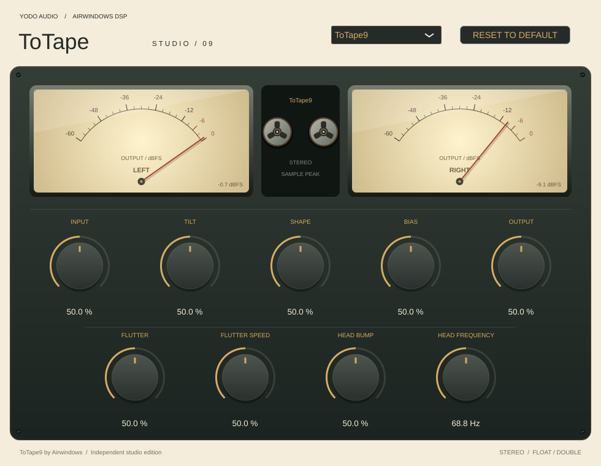
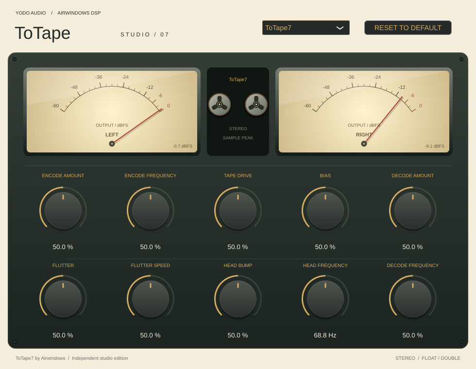

# ToTape Studio

A native UI for **Airwindows ToTape7, ToTape8, and ToTape9**, following the cream, charcoal, and brass
style of [ButterComp Studio](https://github.com/johandoornenbal/codex-tryout).
Built with JUCE as a **VST3 for Apple Silicon Macs (M2 and newer)**. This is an independent adaptation, not an official
Airwindows release.



Choose **ToTape7**, **ToTape8**, or **ToTape9** from the selector at the top.
The controls update to the original parameters of that version. Each version has
its own automatable parameter bank, retained when switching and saved with the
selected version in the host session. Double-click a knob to reset it, type a
value below it, or use Reset to Default to reset only the selected version.
All original parameters default to 50%; head frequency is displayed as 68.8 Hz
(the underlying default is 68.75 Hz).

ToTape9 remains the default. Existing ToTape9 sessions and automation retain their
original parameter IDs/order; older session states without a version selector
load as ToTape9. The plugin identity is unchanged.

Version selection takes effect at the next audio block. The entering engine is
reset to its original initial state, with its retained parameter values applied.
No crossfade, smoothing, normalization, or extra effect is inserted into the DSP.
Switch at a quiet point or with playback stopped to avoid an audible discontinuity.

**ToTape8 and ToTape9 controls:**

| Control | Display | Meaning |
| --- | --- | --- |
| Input | 0–100% | Original squared input drive; 50% = unity |
| Tilt | 0–100% | Dubly encode/decode balance |
| Shape | 0–100% | Dubly encode/decode filter shape |
| Flutter | 0–100% | Flutter depth; 0% disables modulation |
| Flutter speed | 0–100% | Original flutter speed mapping |
| Bias | 0–100% | Under/overbias; 50% = neutral |
| Head bump | 0–100% | Low-frequency resonance amount |
| Head frequency | 25–200 Hz | Resonance frequency; default 68.75 Hz |
| Output | 0–100% | Original output gain before the clipping stage; 50% = unity |

**ToTape7 controls:** Encode amount, Encode frequency, Tape drive, Flutter,
Flutter speed, Bias, Head bump, Head frequency, Decode amount, and Decode
frequency. All except Head frequency use normalized 0–100% displays, preserving
the original mappings. Encode/decode frequency are normalized filter controls,
not Hz readouts. Tape drive at 50% is unity. ToTape7 has no separate Output knob.



[ToTape8 editor preview](docs/ui-preview-8.png)

Stereo input/output; 32- and 64-bit floating-point processing. The output meters
use illuminated analogue faces, red needles and a −60 to 0 dBFS scale, styled
after ButterComp Studio. They show stereo sample peaks after processing, with
visual decay and a −60 dBFS floor. They are not VU, loudness, or true-peak meters. Reel motion is decorative
and follows signal activity, not simulated physical tape speed. The original output stages are retained:
ClipOnly2 for ToTape7/8, ClipOnly3 for ToTape9. One sample of small-signal latency is reported
to the host; flutter additionally introduces its original variable delay.
Parameters are sampled once per audio block, as in the original plugin.

## Build on your Mac

Install Xcode Command Line Tools (`xcode-select --install`) and CMake 3.22+
(for example, `brew install cmake`). From the repository root:

```sh
cmake -S . -B build-mac -DCMAKE_BUILD_TYPE=Release \
  -DCMAKE_OSX_ARCHITECTURES=arm64 -DCMAKE_OSX_DEPLOYMENT_TARGET=11.0
cmake --build build-mac --config Release --parallel 3
ctest --test-dir build-mac -C Release --output-on-failure
```

The first configure downloads pinned JUCE 8.0.12. An existing copy can be supplied
with `-DJUCE_PATH=/absolute/path/to/JUCE`.

The output is `build-mac/ToTapeStudio_artefacts/Release/VST3/ToTape Studio.vst3`.
To install locally:

```sh
codesign --force --deep --sign - "build-mac/ToTapeStudio_artefacts/Release/VST3/ToTape Studio.vst3"
mkdir -p "$HOME/Library/Audio/Plug-Ins/VST3"
ditto "build-mac/ToTapeStudio_artefacts/Release/VST3/ToTape Studio.vst3" \
  "$HOME/Library/Audio/Plug-Ins/VST3/ToTape Studio.vst3"
```

Restart or rescan plugins in your VST3-compatible DAW. Logic Pro requires Audio
Unit and cannot load this VST3 build. Ad-hoc signing is for local use;
distribution requires appropriate Developer ID signing and notarization.

GitHub Actions builds and tests the arm64 VST3 on macOS, ad-hoc signs the bundle,
and uploads `ToTape-Studio-macOS-arm64.zip`. The archive contains only the VST3
bundle, matching ButterComp's build setup.

## Checks

```sh
# Engine checks without JUCE, GUI libraries, or an audio device:
cmake -S . -B build-dsp -DTAPE_DSP_ONLY=ON -DCMAKE_BUILD_TYPE=Release
cmake --build build-dsp --parallel 3
ctest --test-dir build-dsp --output-on-failure
```

The three DSP suites cover parameter extremes, rates from 44.1 to 192 kHz, variable
block lengths, deterministic reset, and impulse latency. The three reference
suites compile the untouched upstream processing source behind a small test-only
VST2 interface and compare float/double processing including silence and parameter
changes. Both implementations use the same deterministic dither seeds.
The JUCE wrapper check verifies all three banks and their selector/slider bindings,
independent reset, state recall, legacy ToTape9 migration, float/double routing,
host latency, and rendering each native editor. It writes `ui-preview.png`,
`ui-preview-7.png`, and `ui-preview-8.png` in the build directory.

The managed Linux cloud instance remains available for development validation:
run `bash scripts/setup-cloud.sh`, then `source scripts/cloud-env.sh` in new
shells. It builds a Linux VST3 for checks; the release workflow produces the
macOS arm64 VST3. AU and standalone targets are not built.

## Licenses

Airwindows ToTape7/8/9 © Chris Johnson / Airwindows, MIT. Wrapper/UI: MIT.
JUCE is separately licensed under AGPLv3 or commercial terms; the wrapper's MIT
license does not relicense JUCE. See [THIRD_PARTY.md](THIRD_PARTY.md).

## Verified in this cloud instance

Linux VST3 compilation passed. All seven CTest suites passed: 63 DSP
scenarios, 144 upstream comparisons with maximum absolute error 0, and the JUCE
wrapper/editor checks for all three versions.
No physical audio device is available here; audio checks render test buffers.
The screenshot above comes from the actual editor. Native macOS compilation,
signing, and DAW playback have not been executed in this Linux instance.
